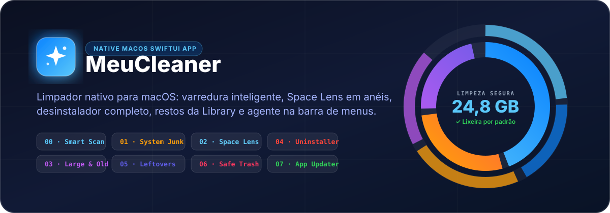
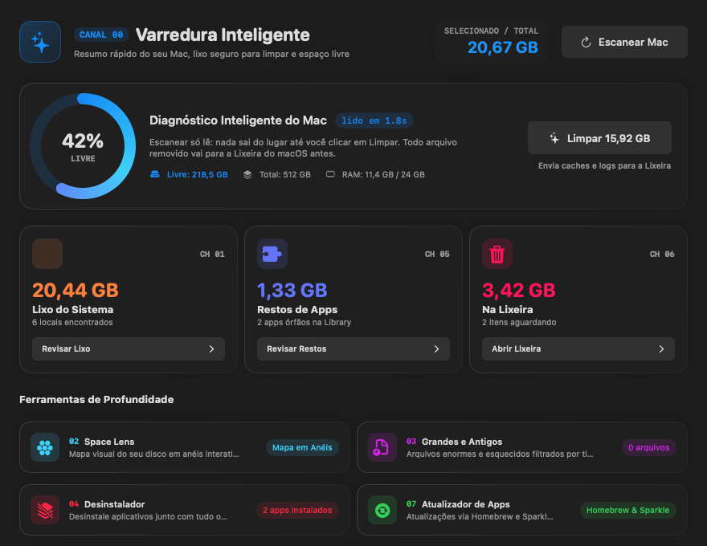
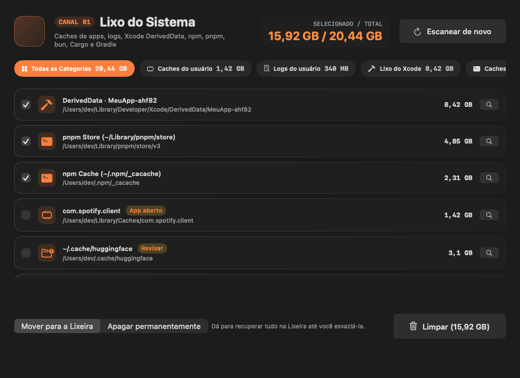
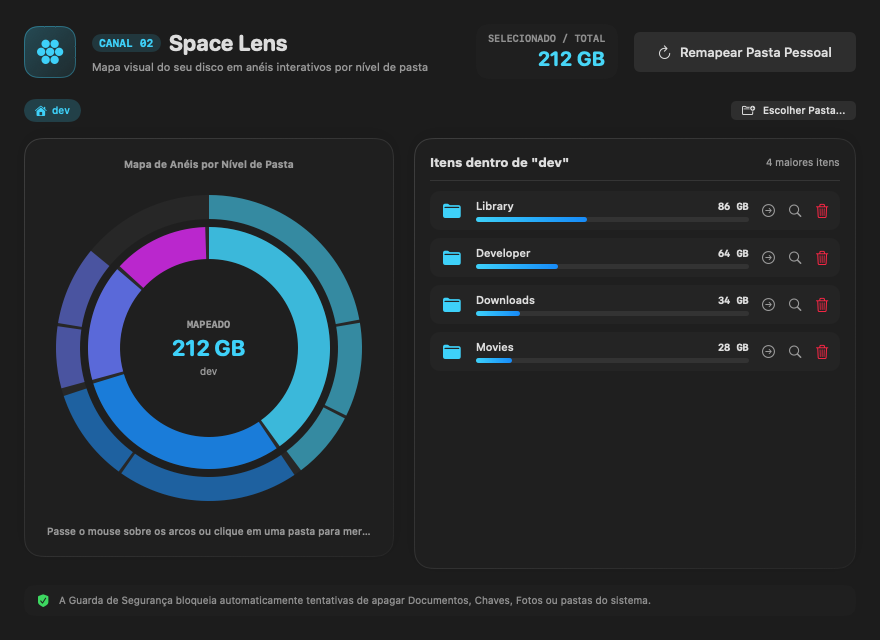
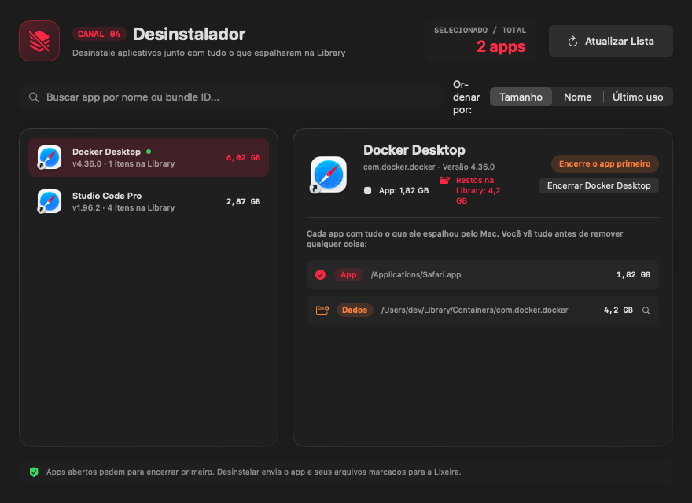
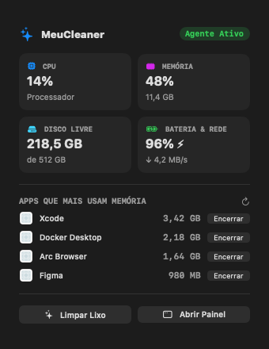

<p align="center">
  
</p>

<p align="center">
  
</p>

<h1 align="center">✨ MeuCleaner</h1>

<p align="center">
  <strong>Limpador nativo para macOS em Swift + SwiftUI — rápido, transparente e seguro por padrão.</strong><br/>
  Acha o lixo do sistema, mapeia o disco em anéis interativos (Space Lens), desinstala apps sem deixar restos na Library, monitora CPU/RAM na barra de menus e permite revisar os itens e o destino antes de qualquer remoção.
</p>

<p align="center">
  <a href="https://github.com/vagneralencar/MeuCleaner-Mac/releases/latest">
    
  </a>
  
  
  
  
</p>

---

## Interface simplificada (1.5.0)

A navegação principal passa a ter **Visão geral**, **Revisar limpeza** e **Histórico**.
Space Lens, Arquivos Duplicados e Grandes e Antigos têm atalhos fixos em **Explorar**, na lateral. A visão geral reúne cartões coloridos das ferramentas; as demais também ficam em “Ferramentas adicionais”.

- Visão geral mostra disponibilidade do macOS, cobertura e maiores locais encontrados, incluindo dados preservados. Medição não é promessa de espaço liberado.
- CPU, memória, rede e bateria voltam como indicadores informativos, separados dos botões de análise e remoção.
- Duplicados não vêm selecionados automaticamente, indicam falhas de leitura e exigem manter pelo menos uma cópia por grupo na seleção.
- Space Lens e duplicados limitam a espera por leituras bloqueadas pelo macOS e sinalizam resultados incompletos, sem confundi-los com pastas vazias.
- Revisão reúne filtros por aplicativo, busca, grupos de decisão e seleção explícita. Caminhos e detalhes ficam expansíveis.
- Os fluxos de arquivos, duplicados, desinstalação e artefatos abrem a mesma revisão antes de remover; projetos e worktrees continuam bloqueados.
- Histórico persiste resultados por item, falhas, destino e recibos da última operação restaurável. Restauração não sobrescreve destinos existentes.
- Lixeira distingue erro de acesso de vazio confirmado. O mapa inclui ocultos, informa leitura parcial, não segue links/volumes e conta hard links uma vez por nível.
- O catálogo inclui caches internos de Claude/Cursor, Expo, Gradle Wrapper, npm/npx e inventário preservado dos perfis/modelos do Chrome. Aplicativos ativos bloqueiam seus caches.
- A varredura continua limitada a locais conhecidos; acesso ao disco não garante cobertura integral. O mapa é somente leitura.
- A interface não inicia limpeza automaticamente. Docker usa confirmação explícita de remoção permanente; arquivos usam Lixeira por padrão.

As seções de versões anteriores abaixo registram a evolução do aplicativo; os nomes e a navegação atuais são os da versão 1.5.0.

## Revisar e limpar (1.4.0)

O canal **11 · Revisar e limpar** (`⌘E`) inclui **Chrome**, Docker, Xcode, Android e outras ferramentas. Na tela inicial, o botão do Chrome mostra quantas cópias temporárias foram encontradas. A revisão lista itens e motivos, permite selecionar os disponíveis e começa com tudo desmarcado. A Lixeira é o destino padrão; a exclusão permanente exige manter o botão pressionado. Itens protegidos ou em uso ficam bloqueados. O atalho da barra de menus também abre a revisão.

Antes de cada arquivo ser removido, `SafetyGuard` confere novamente arquivos abertos, processos, volumes montados, identidade, caminhos e conteúdo protegido. O resultado informa cada sucesso ou falha e o espaço livre observado antes/depois, sem atribuir toda a variação à limpeza. Desfazer não sobrescreve arquivos e mantém recibos de restaurações pendentes.

Docker tem revisão individual de imagens sem containers (incluindo parados). A remoção valida novamente destino, ID, tags e referências; usa o ID completo, sem `force` e sem remover imagens ancestrais. O cache elegível é limitado a registros revisados, ainda sem uso há mais de 24 horas. O app usa a [API local do Docker Engine](https://docs.docker.com/reference/api/engine/version/v1.56/) diretamente para não herdar um builder remoto do Buildx. Volumes e containers permanecem protegidos. Dados futuros de projetos não são inferidos a partir da ausência atual de containers; cabe ao usuário escolher quais imagens descartar.

O histórico local compara medições completas de caminhos presentes em duas análises. A primeira cria a referência; caminhos novos, leituras parciais e clones APFS não são apresentados como crescimento comprovado. Os dados ficam em `~/Library/Application Support/MeuCleaner/storage-snapshot.json`.

## Docker, Xcode e Android (1.3.1)

O canal **11 · Docker e SDKs** (`⌘E`) exibe abas próprias para Docker, Xcode, Android e outras ferramentas. Está acessível pela barra lateral, pelo botão da tela inicial e pelo canal de caches. O inventário protegido permanece visível mesmo sem candidatos à limpeza. Docker mostra imagens, containers, volumes e cache de builds, incluindo valores zero confirmados. A versão em execução aparece na barra lateral para distinguir um build local do aplicativo instalado.

## Varredura inteligente (1.3.0)

A análise agora distingue **candidatos**, **revisão manual**, **em uso**, **dados preservados** e **não verificado**. Escanear é somente leitura; não executa `prune`, não inicia o Docker e não exclui simuladores.

- Mede arquivos ocultos e árvores profundas, sem seguir symlinks ou atravessar volumes montados. Hard links são contados uma vez por medição. Falhas, limites e falta de permissão aparecem como leitura parcial, nunca como zero seguro.
- Detecta as cópias temporárias `code_sign_clone.*` do Chrome na pasta temporária do usuário. Valida o bundle e mostra o ganho como **desconhecido**: o tamanho medido pode contar blocos APFS compartilhados. Não entra no total de candidatos automáticos.
- Consulta arquivos abertos (`lsof`), processos, aplicativos proprietários de caches e imagens montadas. Falha na consulta bloqueia a limpeza. Xcode/Swift, Java/Gradle e atualizadores ativos recebem proteção conservadora.
- Mostra o uso do Docker local (contexto `desktop-linux`) com timeout e sem alterações. Volumes, `Docker.raw`, emuladores Android, dados de simuladores, Archives e máquinas virtuais são inventário protegido. “Recuperável” no Docker não significa que bancos de dados sejam descartáveis.
- Identifica versões antigas de Codex CLI, Cursor Agent e Claude CLI pelas referências atuais; versões atuais, futuras e não verificáveis são preservadas. O link atual é verificado novamente ao remover.
- Projetos, worktrees, repositórios Git (incluindo `.git` como arquivo), pastas de projetos conhecidas e arquivos sensíveis são preservados. Artefatos de projetos deixam de ser pré-selecionados apenas por idade. A inspeção de simuladores substitui a antiga exclusão direta de indisponíveis.
- Antes de limpar, verifica novamente uso, identidade do item, caminhos e conteúdo protegido. Itens que mudaram, passaram a ser usados ou não puderam ser inspecionados permanecem no disco, com o motivo informado.
- O histórico mostra **tamanho dos itens processados**, não espaço físico liberado. Mover para a Lixeira não libera espaço imediatamente.

O diagnóstico da tela inicial inclui os motivos de preservação, o detalhamento Docker e os avisos de acesso. Acesso Total ao Disco pode ampliar a cobertura; não desativa as proteções do aplicativo. Clones APFS podem compartilhar blocos mesmo quando uma medição informa muitos gigabytes. Não há promessa de um ganho igual à soma de tamanhos.

Testes: `swift test`. Integração opcional, somente de leitura no Mac: `MEUCLEANER_LIVE_SCAN=1 swift test --filter testLiveReadOnlyScanWhenExplicitlyEnabled`. O comando usa ferramentas locais com limites de tempo e não remove dados.

---

## 📸 Screenshots

As capturas abaixo documentam a interface anterior. A versão 1.5.0 usa a navegação e os cartões descritos acima.

### Canal 00 · Varredura Inteligente (Smart Scan)
Diagnóstico de arquivos e caches, espaço livre, Docker e ambientes de desenvolvimento. **Restos de Apps** e **Lixeira** são analisados sob demanda, sem bloquear o relatório principal. Pastas que aguardam permissão recebem aviso após um limite de tempo.

<p align="center">
  
</p>

---

### Canal 01 · Lixo do Sistema (System Junk)
Analisa caches de aplicativos, logs, `DerivedData`, caches de desenvolvimento (`npm`, `Bun`, `Cargo`, `Gradle`), `~/.cache` e downloads incompletos. `DeviceSupport`, o armazenamento do `pnpm` e dados de simuladores são preservados.
> **Segurança inteligente**: Caches em uso ficam bloqueados; itens para revisão manual vêm desmarcados. O uso e a identidade do item são verificados novamente antes de remover.

<p align="center">
  
</p>

---

### Canal 02 · Space Lens (Mapa do Disco em Anéis)
Visualização em anéis concêntricos (*Sunburst*): cada anel representa um nível de pasta, e quanto maior o arco, mais espaço ele ocupa no disco. Clique em qualquer arco ou item da lista para mergulhar nas subpastas.

<p align="center">
  
</p>

---

### Canal 04 · Desinstalador Completo +Agente na Barra de Menus
Arrastar um aplicativo para a Lixeira deixa preferências, caches, containers e estados salvos espalhados na `~/Library`. O **Desinstalador** mostra exatamente cada pasta associada (`Dados`, `Caches`, `Preferências`, `Cookies`, `Compartilhado`) e remove tudo junto. Já o **Agente na Barra de Menus** monitora CPU, RAM, Disco, Bateria e Rede em tempo real.

| Canal 04 · Desinstalador Completo | Agente na Barra de Menus (`MenuBarExtra`) |
| :---: | :---: |
|  |  |

---

## 🎛️ Os 12 Canais (`⌘0` a `⌘9`, `⌘D` e `⌘E`)

| Canal | Atalho | Módulo | O que faz |
| :---: | :---: | :--- | :--- |
| **00** | `⌘0` | **Varredura Inteligente** | Exibe arquivos e caches, dados preservados, Docker, simuladores e limitações de leitura. |
| **01** | `⌘1` | **Lixo do Sistema** | Caches de usuário, logs, `DerivedData`, `npm`, `Bun`, `Cargo`, `Gradle`, `~/.cache` e downloads, com proteção de dados em uso. |
| **02** | `⌘2` | **Space Lens** | Mapa visual interativo em anéis por nível de pasta + navegação com breadcrumbs. |
| **03** | `⌘3` | **Grandes e Antigos** | Localiza arquivos pesados esquecidos filtrados por tipo (`Vídeos`, `Imagens de disco`, `Compactados`, `Áudio`, `Imagens`, `Documentos`) e idade (`90 dias`, `6 meses`, `1 ano`). |
| **04** | `⌘4` | **Desinstalador** | Remove aplicativos junto com todos os arquivos que espalharam na `~/Library`. Detecta apps abertos e oferece botão para encerrá-los antes. |
| **05** | `⌘5` | **Restos de Apps** | Encontra pastas órfãs na `~/Library` de apps que já foram apagados no passado. Nada vem marcado por padrão. |
| **06** | `⌘6` | **Lixeira** | Lista os itens na Lixeira do macOS (`~/.Trash`) e exige **segurar o botão até encher** para esvaziar permanentemente. |
| **07** | `⌘7` | **Atualizador de Apps** | Busca e instala atualizações em 1 clique via **Homebrew Cask**, feeds **Sparkle (`SUFeedURL`)** e **Mac App Store Lookup API**. |
| **08** | `⌘8` | **Dev & IA Cleaner (PRO)** | Encontra `node_modules`, `.next`, `.venv`, `target` e `.build` de projetos inativos, modelos locais de IA (**Ollama**, **Hugging Face**, **LM Studio**) e analisa os dados dos simuladores do Xcode sem apagá-los. |
| **09** | `⌘9` | **Inicialização & Daemons (PRO)** | Gerencia `LaunchAgents` e `LaunchDaemons` ocultos em background com ativação/pausa via `launchctl`. |
| **10** | `⌘D` | **Arquivos Duplicados** | Compara conteúdo em três etapas, informa falhas de leitura e permite selecionar cópias mais antigas para revisão, mantendo ao menos uma cópia na seleção. |
| **11** | `⌘E` | **Revisar e limpar** | Chrome, Docker, Xcode e Android com revisão dos itens, nova verificação de uso e confirmação do destino. |

---

## 🚀 Diferenciais Exclusivos (Pro Suite)

- **👻 Vigia da Lixeira (Trash Watcher)**: Detecta automaticamente quando você joga um `.app` na Lixeira pelo Finder e exibe um alerta imediato caso aquele aplicativo tenha deixado restos órfãos na `~/Library`.
- **🎯 Drop Zone de Desinstalação**: Arraste qualquer `.app` do Finder diretamente para a janela do Desinstalador para mapear todos os arquivos vinculados na `~/Library`.
- **📊 Histórico e Ajustes (`⌘,`)**: Registra resultados por item, destino e falhas. O destino é confirmado em cada revisão; arquivos usam a Lixeira por padrão. Tamanho processado não significa espaço físico liberado.

---

## 🛡️ Filosofia de Segurança (`SafetyGuard`)

1. **Escanear só lê**: Nenhuma varredura move ou altera arquivos no disco.
2. **Lixeira por padrão**: Toda limpeza utiliza `FileManager.default.trashItem` para enviar arquivos à Lixeira do macOS primeiro, permitindo restaurar qualquer item pelo Finder.
3. **Segurar para apagar de vez (`HoldToConfirmButton`)**: A exclusão permanente só acontece se você mantiver o botão pressionado até a barra completar — um clique acidental nunca apaga nada.
4. **Guarda de Caminhos Intocáveis**: A camada `SafetyGuard` recusa qualquer operação em:
   - Pastas do sistema (`/System`, `/usr`, `/bin`, `/sbin`, `/Library`, `/Users/Shared`)
   - Pastas pessoais críticas (`~/Documents`, `~/Desktop`, `~/Pictures/Photos Library.photoslibrary`)
   - Dados sensíveis (`~/Library/Keychains`, `~/Library/Mail`, `~/Library/Messages`)
   - Nuvem (`~/Library/Mobile Documents` / iCloud Drive e `~/Library/CloudStorage` / Google Drive, Dropbox, OneDrive)
   - Daemons essenciais da Apple (`HomeKit`, `CloudKit`, `bird`, `akd`, `nsurlsessiond`, `containermanagerd`)
   - O próprio bundle do `MeuCleaner`.

---

## 🏗️ Arquitetura do Projeto

```text
MeuCleaner/
├── Package.swift
├── scripts/
│   └── build-app.sh                        # Empacota o binário Release em build/MeuCleaner.app
├── Sources/MeuCleaner/
│   ├── MeuCleanerApp.swift                 # Entrypoint @main, WindowGroup, atalhos ⌘0–⌘7 e MenuBarExtra
│   ├── Models/
│   │   ├── Channel.swift                   # Definição dos 12 canais (00 a 11), ícones SF Symbols e cores
│   │   └── ScanModels.swift                # Modelos de Lixo, Space Lens, Desinstalador, Restos e Updates
│   ├── Services/
│   │   ├── SafetyGuard.swift               # Validação estrita de caminhos protegidos e integração com Trash
│   │   ├── DiskScannerService.swift        # Motor assíncrono de varredura e limpeza + parser Sparkle XML
│   │   └── SystemMonitorService.swift      # Telemetria local Mach/IOKit (CPU, RAM, Disco, Bateria, Rede)
│   └── Views/
│       ├── MainView.swift                  # NavigationSplitView com barra lateral translúcida
│       ├── Components/
│       │   ├── GlassCard.swift             # Cartões nativos com Material/Vibrancy do macOS
│       │   ├── HoldToConfirmButton.swift   # Botão de segurança "Segure para confirmar"
│       │   └── SpaceLensRingChart.swift    # Gráfico Sunburst interativo em anéis concêntricos
│       ├── Channels/                       # Telas dedicadas dos canais 00 a 11
│       └── MenuBar/
│           └── MenuBarPopoverView.swift    # Popover do agente na barra de menus
└── Tests/MeuCleanerTests/
    └── MeuCleanerTests.swift               # Testes unitários da Guarda de Segurança e regras de seleção
```

---

## 🚀 Como Compilar e Executar

### Pré-requisitos
- **macOS 14.0 (Sonoma)** ou superior
- **Swift 5.10 / 6.0+** (Xcode 16+ ou Command Line Tools)

### 1. Rodar os testes unitários
```bash
swift test
```

### 2. Executar em modo desenvolvimento
```bash
swift run MeuCleaner
```

### 3. Gerar o aplicativo nativo `MeuCleaner.app` (Release)
```bash
chmod +x scripts/build-app.sh
./scripts/build-app.sh
open build/MeuCleaner.app
```

---

## 📄 Licença

Distribuído sob a licença MIT.
